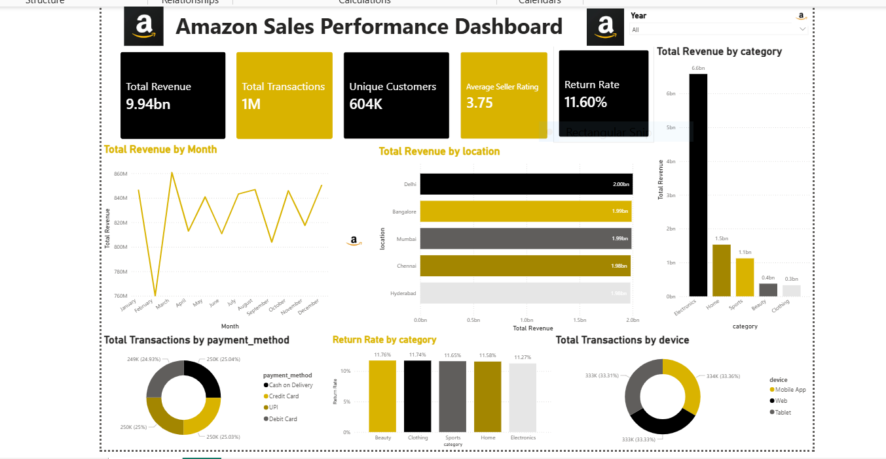
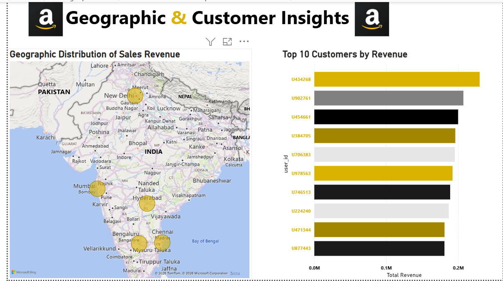

# Amazon Sales Performance Analysis | Power BI

## Project Overview

This project presents an end-to-end Business Intelligence analysis of a synthetic e-commerce dataset containing approximately 1 million sales transactions.

The objective is to evaluate sales performance, customer activity, product category performance, geographical revenue distribution, and product returns using interactive Power BI dashboards.

The project demonstrates practical skills in data preparation, transformation, DAX calculations, data visualization, and business reporting.

### Tools and Technologies
- **Microsoft Excel:** Initial data inspection and validation
- **Power Query:** Data cleaning and transformation
- **Power BI:** Data modeling, DAX measures, and interactive dashboard development

### Dashboard Structure
1. **Executive Sales Overview:** Revenue trends, transactions, customer metrics, product categories, and returns.
2. **Geographic & Customer Insights:** Sales distribution across Indian cities and the top 10 customers by revenue.

## Business Problem

E-commerce businesses generate large volumes of transactional data, but transforming this data into actionable business insights can be challenging.

Without effective performance monitoring, businesses may struggle to identify revenue trends, understand customer purchasing behaviour, evaluate product category performance, and monitor product returns.

This project addresses these challenges by developing an interactive Power BI dashboard that supports data-driven decision-making.

## Project Objectives

The analysis aims to:

1. Evaluate overall sales performance using key revenue and transaction metrics.
2. Identify the highest-performing product categories.
3. Analyse monthly revenue trends to understand sales fluctuations.
4. Examine geographical revenue distribution across major Indian cities.
5. Evaluate customer activity and identify the top 10 customers by revenue.
6. Analyse product return rates across different categories.
7. Compare customer payment methods and purchasing devices.
8. Develop interactive dashboards that communicate business performance clearly to stakeholders.

## Data Preparation and Cleaning

The project followed a structured data preparation workflow using Microsoft Excel and Power Query before developing the Power BI dashboards.

### 1. Data Inspection

The initial data inspection focused on understanding the structure and quality of the synthetic e-commerce dataset.

Key areas examined included:
- Column names and data types
- Missing and empty values
- Data consistency across fields
- Transaction and customer identifiers
- Numerical fields used for sales performance analysis

### 2. Data Transformation Using Power Query

Power Query was used to prepare the dataset for analysis.

The data quality review included:
- Checking column quality indicators for valid, empty, and error values
- Reviewing text and numerical data types
- Inspecting product categories, customer identifiers, and location fields
- Checking the suitability of the dataset for analytical reporting

### 3. Data Validation

Data validation focused on ensuring that the information used in the dashboard was consistent with the underlying dataset.

The validation process included reviewing:
- Total transaction counts
- Revenue calculations
- Unique customer counts
- Product category classifications
- Return rate calculations

### 4. Data Modeling and DAX

Power BI and DAX measures were used to calculate key business performance indicators, including:

- Total Revenue
- Total Transactions
- Unique Customers
- Average Seller Rating
- Return Rate

These measures support interactive reporting and allow business performance to be analysed across different dimensions.

## Key Performance Indicators (KPIs)

Five key performance indicators were developed using DAX in Power BI to evaluate the performance of the e-commerce dataset.

| KPI | Result | Business Interpretation |
|---|---|---|
| Total Revenue | 9.94 Billion | Total recorded sales revenue |
| Total Transactions | Approximately 1 Million | Overall transaction volume |
| Unique Customers | Approximately 604,000 | Number of distinct customers |
| Average Seller Rating | 3.75 / 5 | Average seller performance rating |
| Return Rate | 11.60% | Percentage of transactions recorded as returned |

## Key Business Insights

### 1. Sales Performance

The dataset generated approximately 9.94 billion in total revenue across approximately one million transactions.

Monthly revenue remained relatively stable, with moderate fluctuations and no major sustained increases or decreases.

### 2. Product Category Performance

Electronics was the leading revenue-generating category, contributing approximately 6.6 billion in revenue.

Other categories, including Clothing, Home, Beauty, and Sports, contributed smaller amounts.

This indicates that Electronics was the primary revenue driver within the dataset.

### 3. Geographic Sales Distribution

Revenue was distributed relatively evenly across five Indian cities:

- Delhi
- Bangalore
- Mumbai
- Chennai
- Hyderabad

Delhi recorded the highest revenue, although the differences between cities were relatively small.

### 4. Customer Analysis

The dashboard identified approximately 604,000 unique customers.

A separate customer insights dashboard was developed to identify the top 10 customers by total revenue, supporting analysis of high-value customer activity.

### 5. Product Returns

The overall product return rate was 11.60%.

Return rates were relatively similar across product categories, indicating that returns should be monitored across the business rather than focusing exclusively on one category.

### 6. Payment Methods and Device Usage

Payment methods were distributed relatively evenly, without a single dominant payment option.

Customer transactions were also spread across mobile applications, web browsers, and tablets.

These findings highlight the importance of maintaining multiple payment options and providing a consistent purchasing experience across devices.

## Business Recommendations

Based on the dashboard findings, the following recommendations are proposed:

### 1. Strengthen High-Performing Product Categories

Electronics generated the highest revenue among all product categories.

The business should prioritise monitoring Electronics sales performance, inventory availability, and customer demand while identifying opportunities to grow other product categories.

### 2. Improve Customer Retention

With approximately 604,000 unique customers, the business has a substantial customer base.

Further analysis of repeat purchases, customer lifetime value, and purchasing frequency could help identify opportunities to improve customer retention.

### 3. Monitor Product Returns

The overall return rate of 11.60% suggests that product returns deserve continued management attention.

The business should investigate potential return reasons, evaluate product quality, and monitor return patterns across categories.

### 4. Maintain a Consistent Multi-Channel Experience

Transactions occurred across different devices and payment methods.

The business should maintain reliable payment options and optimise the purchasing experience across mobile, desktop, and tablet devices.

### 5. Support Geographic Growth

Sales were distributed across five major Indian cities.

The business could use city-level performance monitoring to identify opportunities for targeted marketing, customer acquisition, and regional expansion.

## Project Limitations

- **Synthetic Dataset:** The analysis uses simulated e-commerce transactions and does not represent actual Amazon sales performance.
- **Limited Customer Information:** Customer identifiers were available, but customer names and detailed demographic information were not included.
- **Limited Return Analysis:** The dashboard measures return rates but does not establish the underlying reasons for product returns.
- **Descriptive Analysis:** The project focuses on historical performance monitoring rather than predictive forecasting.
- **Business Recommendations:** Recommendations are based on observed dashboard patterns and would require further validation using real business data.

## Dashboard Screenshots

### 1. Executive Sales Overview

### 2. Geographic & Customer Insights

## Dashboard Video Demonstration

A 45-second walkthrough of the interactive Power BI dashboard, showcasing its visualizations and reporting features.

🎥 [Watch the Power BI Dashboard Demo](Amazon_Dashboard_Demo.mp4)

## Download Power BI Report

The complete interactive Power BI dashboard is available for download.

📊 [Download Amazon Sales Performance Dashboard (.pbix)](PowerBI/Amazon%20Sales%20Performance%20Dashboard.pbix)

Open the downloaded file using Microsoft Power BI Desktop to explore the dashboard and its visualizations.

